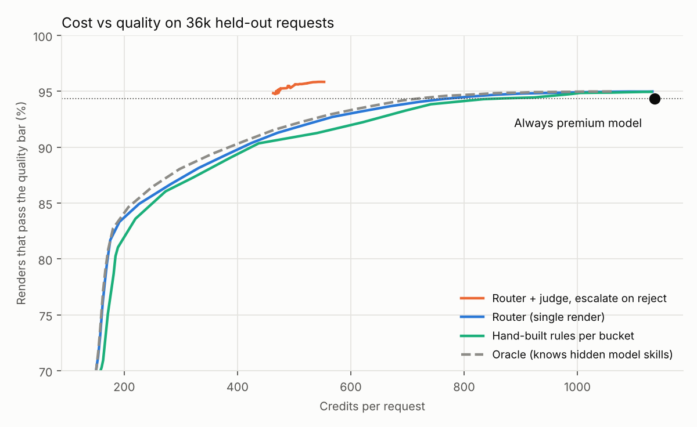
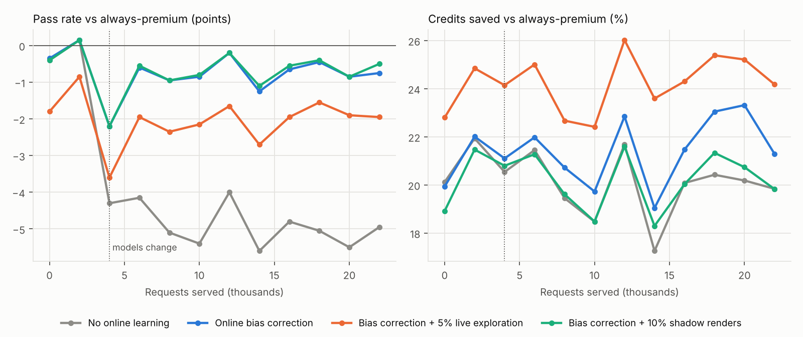

# Model router for the Magic Hour API

Picks the cheapest Magic Hour model that is likely to pass your quality bar, request by request.
A PyTorch classifier predicts, for each of 14 image and video models, the probability that a render
of *this* prompt at *this* resolution and duration passes a draft, standard or premium bar. A policy
then trades credits against that probability. The whole thing runs as a FastAPI service with Postgres
and Redis and learns from feedback while it serves.

**Headline (36k held-out requests):** at the same pass rate as always using the premium model, the
router spends **18% fewer credits** from a single render, and **59% fewer** when the client runs an
automatic judge and lets the router escalate rejected renders to the premium model.

**Stack:** Python 3.13, PyTorch, FastAPI, Postgres 16, Redis, Docker Compose.

> **Read this first: the training data is simulated.** No eval harness with per-model quality labels
> exists yet, so `sim/world.py` stands in for one (details [below](#the-simulated-eval-harness)). The model
> names, supported resolutions and credit costs are real. The hidden per-model quality profiles are
> invented and are **not** claims about how the real models compare. Everything downstream (features,
> training, calibration, the service, the benchmarks) is real code that would run unchanged on real eval
> data. A small live check against the real API is at the end.



## Results

### Credits saved at equal quality (offline, `bench/offline.py`)

Each held-out request was rendered on *every* eligible model, so every policy's choice has an actual
pass/fail outcome; nothing below is a predicted pass rate. Policy parameters are tuned on a separate
validation split to match the premium model's pass rate in each (task, quality bar) slice, then
measured once on the test split. Δ is the pass rate difference from always-premium with a 95%
bootstrap interval.

| Policy (36,000 test requests) | Pass rate | Δ vs premium | Credits / request | Saved |
|---|---|---|---|---|
| Always the premium model (nano-banana-pro / seedance-2.0) | 94.3% | baseline | 1,137 | baseline |
| Always the cheapest eligible model | 54.0% | −40 pts | 139 | 88% |
| Hand-built rules: best model per (task, resolution, has-text, duration) bucket | 94.6% | +0.1 to +0.4 | 1,107 | 2.6% |
| Logistic regression on the same features | 94.4% | −0.1 to +0.2 | 1,057 | 7.0% |
| **Router, single render** (PassNet + Lagrangian policy) | **94.4%** | **−0.1 to +0.2** | **932** | **18.0%** |
| Oracle router (knows the hidden model profiles) | 94.4% | −0.1 to +0.2 | 948 | 16.6% |
| Naive cascade: cheapest model, escalate to premium on reject | 92.6% | −1.9 to −1.6 | 611 | 46.2% |
| Cascade with hand-built rules | 94.7% | +0.3 to +0.5 | 492 | 56.7% |
| **Router + judge, escalate on reject** (PassNet cascade) | **95.0%** | **+0.5 to +0.8** | **468** | **58.8%** |
| Oracle cascade | 94.9% | +0.4 to +0.7 | 470 | 58.6% |

What this says, including the parts that don't flatter the model:

- **Without a judge, learning from the prompt is what saves money.** Hand-built bucket rules save
  2.6%; the router saves 18.0% at the same quality. The router matches the oracle within noise
  (its 18.0% vs the oracle's 16.6% is tuning noise, not the router beating perfect knowledge).
- **With a judge, the cascade structure does most of the work.** Even hand-built rules save 56.7%
  once rejected renders can be escalated; the learned router adds about 2 points and escalates fewer
  requests (20.1% vs 22.3%, i.e. fewer requests pay double latency). The naive cascade saves less
  *and* loses quality, because it sends hard prompts to models that will clearly fail.
- **The judge's accuracy matters.** The cascade assumes a runtime judge (e.g. a vision model) that
  agrees with the eval label 95% of the time. Re-tuned for each accuracy level: 80% judge accuracy →
  40.9% saved, 90% → 49.3%, 95% → 58.8%, perfect → 61.5%, all at or above premium quality.
- **PassNet vs logistic regression is closer than the routing numbers suggest.** On prediction metrics
  they are near-identical (AUC 0.924 vs 0.926, log loss 0.296 vs 0.291), and logistic regression is
  better calibrated (ECE 0.0045 vs 0.017). PassNet's advantages are one network for all 14 models,
  the ordinal head (P(premium) ≤ P(standard) ≤ P(draft) by construction) and warm-start fine-tuning
  from feedback. The single-render savings gap (18.0% vs 7.0%) is real on this test set but should be
  re-checked on real eval data before anyone relies on it.
- **Where savings come from.** Most credits are video, and seedance-2.0 costs about 7x the next
  model, so the big single-render wins are draft-bar images (59% saved), draft-bar video (54%) and
  standard-bar images (33%). For standard and premium video the premium model is rarely substitutable
  without a judge (5% and 2% saved); with one, those slices save 59% and 44%.

Prediction quality on the test split (pass/fail at the requested bar, all eligible models):

| Predictor | AUC | Log loss | Brier | ECE |
|---|---|---|---|---|
| Bucket rules (empirical pass rates) | 0.878 | 0.365 | 0.117 | 0.003 |
| Logistic regression | 0.926 | 0.291 | 0.091 | 0.005 |
| PassNet | 0.924 | 0.296 | 0.092 | 0.017 |
| Oracle (Bayes-optimal given hidden profiles) | 0.931 | 0.281 | 0.087 | 0.002 |

### Learning from feedback when models change (`bench/drift.py`)

24,000 fresh requests go through the **live service** (3 workers, Postgres, Redis). The simulator renders on
whatever model the service picks and posts the outcome to `/v1/feedback`. After 4,000 requests, without
telling the router: gpt-image-2 regresses badly (it was getting 15% of traffic), flux-schnell ships a
better version, and kling-3.0 turns out to bill 0.6x the catalog price.



| After the change (20k requests) | Pass rate vs premium | Credits saved | Traffic to the regressed model (avg) |
|---|---|---|---|
| No online learning | −4.9 pts | 19.9% | 15.3% (unchanged) |
| **Online bias correction** | **−0.9 pts** | **21.4%** | **1.7%** |
| Bias correction + 5% exploration | −2.2 pts | 24.3% | 1.9% |

- The online correction is one SGD step per feedback on a per-model logit offset, kept in Redis and
  shared by all workers. Traffic to the regressed model fell from 15% to 2% within about 4,000
  requests and stayed under 1% after that. The live cost EMA picked up kling-3.0's lower real price,
  but that barely changed routing (its share went from 7.0% to 7.4%).
- Exploration found the improved cheap model (its share grew from 2% to 8%) and saved the most, but
  sending 5% of customer traffic to cheaper models cost about 1.3 points of quality. In production
  I'd run exploration on shadow renders paid for out of the savings, not on customer requests.
- The nightly retrain ran at request 12,000 and **the gate rejected it**: the fine-tuned candidate
  scored a worse holdout log loss (0.152) than the live model with its online bias (0.148). That's the
  gate doing its job; with 8k feedback rows labelling one model each, a per-model offset already
  captures most of what changed.

### Service performance (`bench/load.py`)

Measured on a shared 4-core VM with the load generator on the same machine. Every request does a Redis
cache lookup, a PassNet forward pass on a miss, the policy, two Redis writes and an async batched decision
insert into Postgres.

| Setup | Throughput | p50 | p99 |
|---|---|---|---|
| 1 worker, 1 client (unloaded) | 690 req/s | **1.35 ms** | **2.5 ms** |
| 1 worker, 16 concurrent | 910 req/s | 17 ms | 27 ms |
| 1 worker, 64 concurrent | 995 req/s | 60 ms | 155 ms |
| 3 workers, 64 concurrent | **2,490 req/s** | 15 ms | 74 ms |
| 3 workers, 64 concurrent, 50% repeated prompts (cache hits) | 3,190 req/s | 11 ms | 68 ms |

Things I learned profiling it with py-spy: the PassNet forward pass is about 0.1 ms, so the model is not
the bottleneck; the HTTP stack is. Switching uvicorn from h11 to httptools/uvloop and serializing with
orjson gave +19% throughput. Micro-batching concurrent requests into one forward pass gave +24% with a
single worker but was *slower* with three, so it's off by default (`ROUTER_BATCHING=1` turns it on).
The original httpx load generator burned more CPU than the server, so the benchmark uses a raw-socket
keep-alive client.

### Live check against the real Magic Hour API

Six image requests (640px) went through `POST /v1/generate`, which routed each one and submitted it to
the real API. The router picked flux-schnell (2), krea-2 and gpt-image-2 (3) and was charged **170
credits**, vs **450** for the premium default at 640px (seedream-v5-pro, since nano-banana-pro doesn't
render 640px). On a visual review all six met their bar, including the two with
rendered text ("GRAND OPENING", a four-line chalkboard menu). Six renders prove the integration works end
to end; they are not a quality benchmark. Log: `results/real/generate_log.json`, images:
`results/real/contact_sheet.jpg`.

## How it works

```
 client ── POST /v1/route ──▶ FastAPI worker (×N, stateless)
                                │ 1. Redis: score cache (blake2b of normalized request + model version)
                                │ 2. miss → PassNet forward (0.1 ms)  ──▶ (14 models × 3 bars) logits
                                │ 3. + per-model online bias, × live cost scale (snapshotted from Redis 1/s)
                                │ 4. policy: Lagrangian / threshold / cascade, max_credits, allowed_models
                                │ 5. ε-exploration among cheaper models, propensity logged
                                └─▶ async batched INSERT into Postgres `decisions`
 client ── POST /v1/feedback ─▶ Postgres `feedback` (idempotent per decision)
                                └─▶ Redis: bias += lr·(y − p); cost EMA (atomic Lua); calibration counters
 nightly ── router.retrain ───▶ export feedback (1/propensity weights) → fine-tune → gate on fresh holdout
                                └─▶ model_registry (one active row) → Redis PUBLISH → workers hot-swap
```

**PassNet** (`router/model.py`). Prompt words and bigrams are hashed into a 65k-row `EmbeddingBag`;
quoted text is replaced by a length token so the model learns "renders five words of text", not specific
slogans. Dense features cover task, resolution, aspect, duration, start frame and quoted-word count. A
two-layer MLP produces a latent quality score per catalog model, and an ordinal (cumulative-link) head
turns it into P(pass) at each bar with increasing cut points, so bars can never contradict each other.
Per-model temperature scaling is fitted on validation data after training.

**Policies** (`router/policy.py`).
- *Lagrangian (default):* pick argmin over models of `credits − λ·P(pass)`, with λ = κ × the premium model's
  price so one κ means the same trade-off for a 5-credit image and a 2,600-credit video. κ is tuned per
  (task, bar) to match premium quality on validation data.
- *Threshold:* cheapest model with P(pass) ≥ τ, else the most likely to pass.
- *Cascade (`"mode": "cascade"`):* plan two steps, a first model and an escalation to premium if the
  client's judge rejects it, minimizing expected credits minus λ × expected pass.

The service also honours `max_credits` and `allowed_models`, filters models by supported resolution and
duration, and returns every alternative with its probability and estimated cost.

## The simulated eval harness

`sim/world.py` generates requests from a prompt grammar (subjects, actions, quoted text, counting,
styles, detail modifiers, camera moves; several phrasings each). 40% of requests are simple (one subject,
a style, a gentle shot), because real traffic has a heavy head of easy prompts. Each fragment carries a
demand vector over 10 capabilities (text rendering, photorealism, anatomy, composition, fine detail,
stylization, motion, physics, temporal consistency, camera work); resolution and duration add to them.

Each model has a hidden skill vector and base quality. A render's quality is
`base − softmax_k(w_k·demand_k·(1 − skill_k)) − 0.12·Σ gaps + prompt_difficulty + render_noise`.
The soft maximum means a render usually fails on its worst defect (garbled text *or* a sixth finger),
which makes capabilities interact. `prompt_difficulty` is shared across models but invisible in the
prompt, and render noise is per render, so even the oracle can't predict perfectly. A judge with its own
noise passes or fails each render at three thresholds.

The dataset is 90,000 requests (30k train, 24k validation, 36k test), each rendered on every eligible
model: 570k labelled renders. Train is kept at a size a real eval sweep could afford; validation and test
are large so the "equal quality" comparisons have tight intervals.

**Credit costs** (`router/catalog.py`): image prices are the documented "from N credits/image" figures
in the Magic Hour API reference. Video prices come from credits we were actually charged (kling-2.6,
ltx-2, kling-3.0, seedance-2.0); seedance-2.0-mini and veo3.1-lite are placeholders. Resolution
multipliers are assumptions. The service corrects all of these online from `credits_charged`.

## Running it

```bash
pip install -r requirements.txt
python -m sim.world --n 90000                    # simulated eval sweep -> data/eval.jsonl
python -m router.train --epochs 12 --emb 32 --buckets-log2 16 --wd 0.01
python -m bench.offline                          # results/offline.json, models/tau.json

docker compose up --build                        # router + Postgres + Redis on :8000
# or natively, with Postgres and Redis running:
python -m router.registry register models/passnet.pt --tau models/tau.json --activate
uvicorn router.service:app --workers 3

curl -s localhost:8000/v1/route -H 'content-type: application/json' -d '{
  "task": "image", "prompt": "a bowl of fruit, watercolor illustration",
  "resolution": "1k", "quality": "standard"}'

python -m bench.load --procs 1 --conc 64          # load test
python -m bench.drift --arm bias                  # drift replay through the live service
python -m router.retrain                          # fine-tune on feedback, gate, hot-swap
pytest -q                                         # unit + integration tests (need Postgres/Redis)
```

The Docker files are written but not run here (no Docker daemon in my environment); everything above
was run natively against Postgres 16 and Redis 7.

## What I'd do next

- Replace the simulator with a real eval sweep: a few thousand production-like prompts rendered on each
  model and labelled by people plus a vision-model judge. The trainer already reads that row format, and
  production feedback uses the same path.
- Measure the runtime judge's real agreement with human labels, since the cascade's savings depend on it.
- Use the logged propensities for off-policy evaluation (IPS / doubly robust) of new policies before
  shipping them.

## Resume bullet

> Built a cost-aware model router for the Magic Hour generative-media API (PyTorch, FastAPI, Postgres,
> Redis). A calibrated multi-model pass-probability network plus a Lagrangian routing policy cut credits
> 18% at equal quality on 36k held-out requests (59% with judge-gated escalation), vs 2.6% for
> hand-built rules. Online feedback correction recovered from a silent model regression within ~4k
> requests (−4.9 → −0.9 pts vs premium); the service routes in 1.35 ms p50 and 2.5k req/s on 3 workers.
